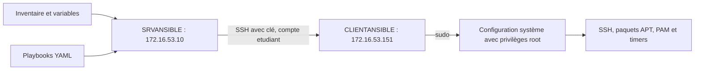

# Ansible : fonctionnement et utilisation dans la situation ECOCERT

> :bust_in_silhouette: **Fiche rédigée par** : GADONNAUD Ewen  
> :mortar_board: **Formation** : BTS SIO 2ème année - Option SISR  
> :school: **Établissement** : Lycée Paul-Louis Courier, Tours  
> :calendar: **Date** : Novembre 2026

## Pourquoi Ansible dans cette situation ?

ECOCERT souhaite maintenir une salle de postes Debian 13 Cinnamon avec une configuration homogène. Répéter manuellement les installations et réglages sur chaque poste prend du temps et favorise les écarts. Le projet décrit les actions dans des fichiers réutilisables, puis les applique d’abord à un client pilote.

La [situation professionnelle 3](../../missions/sp3-ansible.md) présente les manipulations et leurs captures. La [documentation des playbooks](ansible-playbooks.md) détaille le code, ses paramètres et ses limites.

## Contrôleur, inventaire et postes gérés

Ansible est lancé depuis un **contrôleur**, ici SRVANSIBLE. L’**inventaire** définit les machines ciblées et leurs paramètres de connexion. Les **playbooks** YAML associent ces cibles à des tâches ; chaque tâche utilise un module spécialisé. Le client n’a pas besoin d’un agent Ansible permanent : dans notre laboratoire, SSH et Python 3 constituent les prérequis distants. [Concepts Ansible](https://docs.ansible.com/projects/ansible/latest/getting_started/basic_concepts.html)



Le schéma représente le prototype dans le VLAN 53. Le sujet impose une recette dans le VLAN Formations professionnelles et le nom CONFECOCERT pour le contrôleur ; ces points restent à valider dans la maquette finale.

## Déroulement d’une exécution

Sur SRVANSIBLE, depuis le dossier du projet :

```bash
ansible-playbook playbooks/02-applications.yml --limit CLIENTANSIBLE -K --diff
```

Ansible lit sa configuration, l’inventaire et les variables, sélectionne le client, ouvre la connexion SSH et exécute les tâches. `--limit CLIENTANSIBLE` restreint la cible à cet alias d’inventaire. L’alias doit donc exister exactement sous ce nom. [Sélection des hôtes](https://docs.ansible.com/projects/ansible/latest/user_guide/intro_patterns.html)

La clé SSH authentifie le compte `etudiant`. `become: true` demande ensuite l’élévation vers root ; `-K` demande le mot de passe sudo sans le stocker dans l’inventaire. Ces deux mécanismes remplissent des rôles différents. [Élévation de privilèges](https://docs.ansible.com/projects/ansible/latest/playbook_guide/playbooks_privilege_escalation.html)

Le récapitulatif distingue les tâches réussies, les changements, les erreurs et les hôtes injoignables. Un résultat sans échec doit être complété par un contrôle du service ou du fichier modifié.

## Répartition des actions dans notre projet

| Fichier | Utilisation pour ECOCERT |
| --- | --- |
| `00-controles.yml` | Vérifier Debian 13, l’exécution des modules et sudo |
| `01-ssh.yml` | Maintenir la clé autorisée et le bloc de configuration SSH |
| `02-applications.yml` | Installer les applications définies dans les variables, ici htop |
| `03-mises-a-jour.yml` | Déclencher une mise à jour APT à la demande |
| `04-mots-de-passe.yml` | Contrôler la qualité des futurs mots de passe locaux via PAM |
| `05-maj-automatiques.yml` | Configurer la périodicité APT sur le client |
| `site.yml` | Regrouper 00, 01, 02 et 04 après validation individuelle |

Le playbook 05 configure un mécanisme local : les timers APT déclenchent ensuite les opérations sans nouvelle connexion Ansible. Les origines autorisées déterminent les mises à jour concernées ; la présence d’un timer ne prouve pas qu’une installation a réussi.

## Répéter et généraliser le déploiement

Le projet demande un état souhaité, par exemple la présence de htop. Un module adapté évite de réinstaller inutilement un paquet déjà présent : c’est le principe d’**idempotence**. Une mise à jour des index ou l’arrivée de nouveaux paquets peut néanmoins produire des changements lors d’une nouvelle exécution. Le module APT distingue notamment installation et mise à niveau. [Module APT](https://docs.ansible.com/projects/ansible/latest/collections/ansible/builtin/apt_module.html)

Avant généralisation, la recette doit confirmer la nouvelle connexion SSH, le fonctionnement du poste après mise à jour, les tests PAM et les journaux de mise à jour périodique. Les autres clients pourront ensuite rejoindre le groupe `postes`, avec leur propre adresse. Les plays utilisant `serial: 1` traiteront les clients un par un ; les autres conserveront leur stratégie d’exécution configurée.

Le contrôle `--syntax-check` valide la structure Ansible, sans exécuter les tâches sur les postes. Les instantanés et les sauvegardes restent nécessaires pour revenir sur une modification : un playbook n’est pas une transaction avec annulation automatique.
