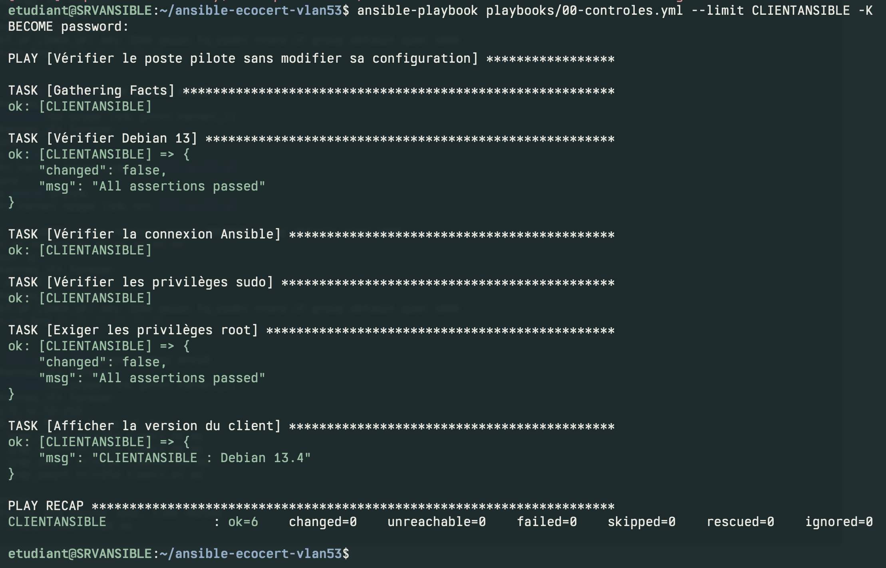
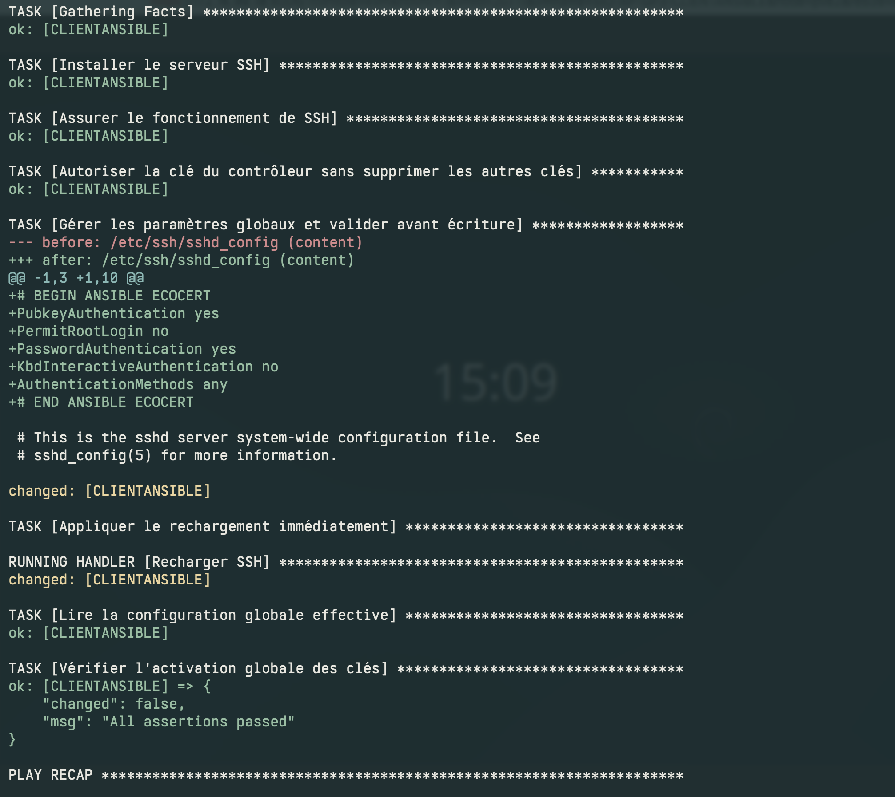
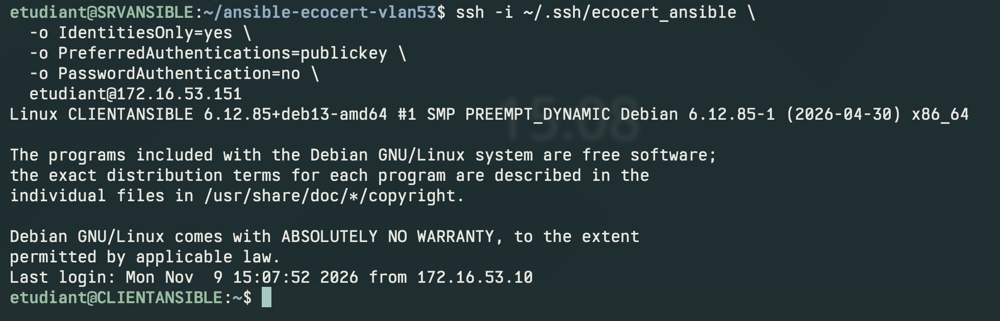
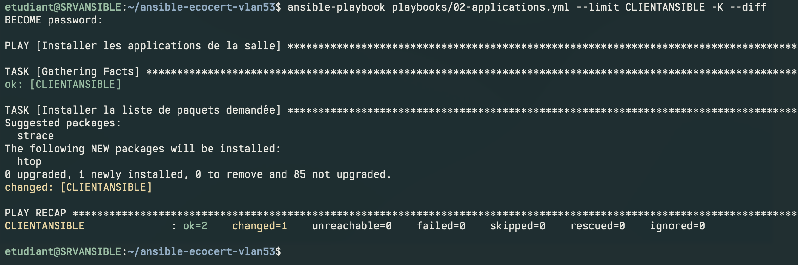
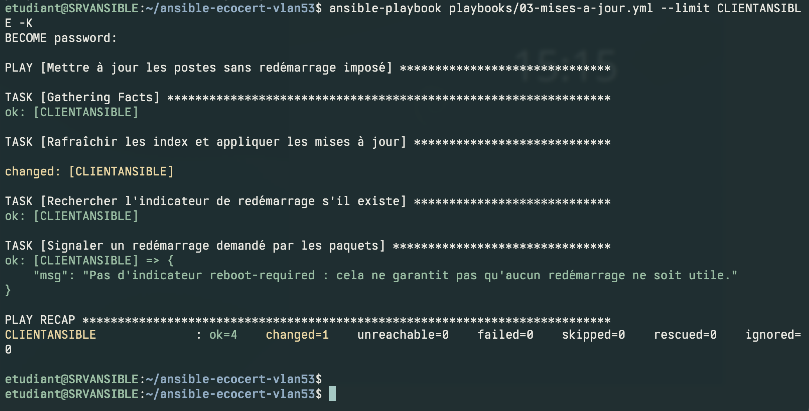
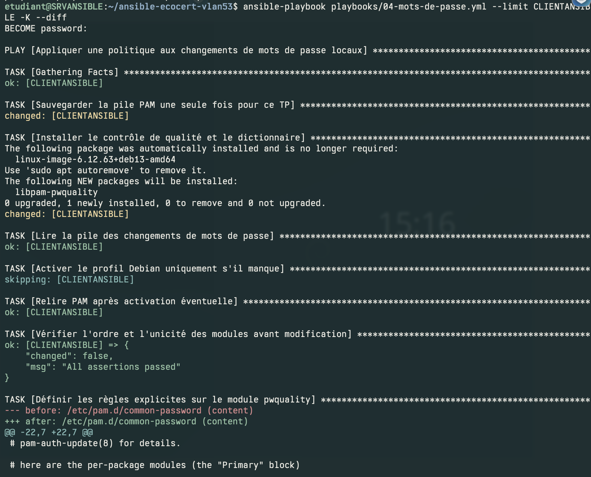
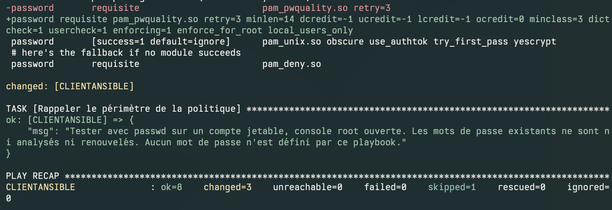
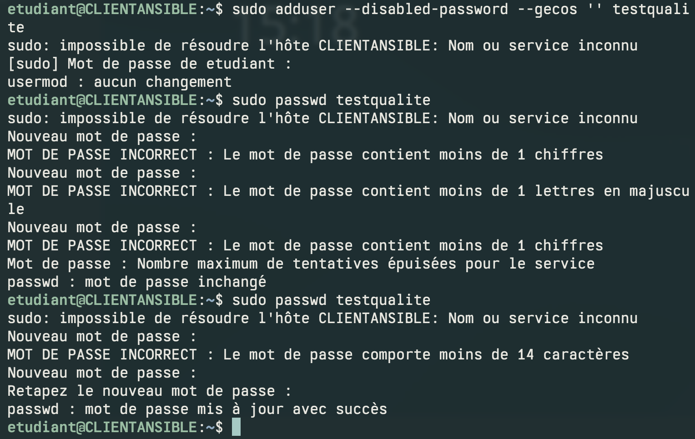
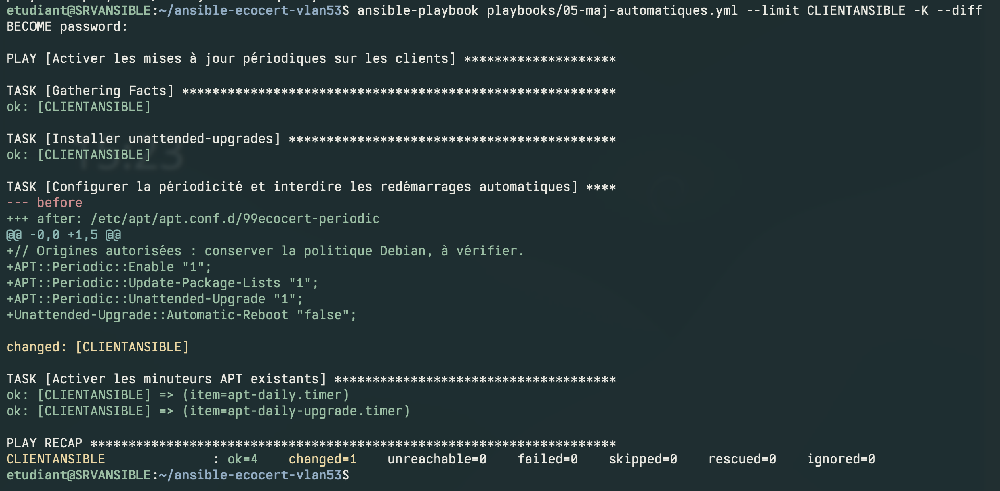
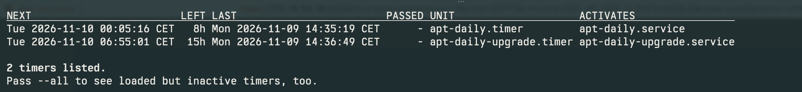

# Situation professionnelle 3 : Automatisation des postes avec Ansible


> :bust_in_silhouette: **Fiche rédigée par** : GADONNAUD Ewen
> :mortar_board: **Formation** : BTS SIO 2ème année - Option SISR  
> :school: **Établissement** : Lycée Paul-Louis Courier, Tours  
> :calendar: **Date** : Novembre 2026

---

## Cadre du laboratoire

ECOCERT souhaite automatiser la configuration, les installations et les mises à jour des postes Debian 13 Cinnamon de sa salle de formation. La mission 1 prépare le contrôleur et les accès ; la mission 2 déploie les playbooks et vérifie leurs effets sur un poste pilote.

Le laboratoire utilise **SRVANSIBLE** et **CLIENTANSIBLE**, tous deux dans le **VLAN 53 Serveurs**. Le sujet demande un contrôleur nommé **CONFECOCERT** et un client dans le VLAN **Formations professionnelles** : le nom du serveur et le placement temporaire du client constituent donc des écarts à valider. Une recette dans le VLAN 41 reste à réaliser. Les schémas décrivent le contexte, sans prouver à eux seuls le raccordement réel des VM.

Python 3 est installé sur le client pour exécuter les modules Ansible. Le playbook `00-controles.yml` vérifie les prérequis avant les modifications.

- [Comprendre Ansible et son utilisation dans cette situation](../documentation/adminsys/ansible.md).
- [Explication détaillée des fichiers et des playbooks](../documentation/adminsys/ansible-playbooks.md).

### Organisation des livrables

Le sujet prévoit quatre semaines et un étudiant. Le suivi Notion doit préciser les tâches et leurs échéances ; aucune date prévisionnelle ni validation de ce suivi n'est attestée par les captures disponibles.

| Mission | Livrables | État documentaire |
| --- | --- | --- |
| 1 — Contrôleur et accès | Installation, inventaire, clé SSH, sudo et contrôle du client | Procédure et captures ci-dessous |
| 2 — Automatisation | SSH, application, mises à jour, politique PAM, périodicité et recette | Playbooks expliqués et essais sur le pilote |
| Validation finale | Essai dans le VLAN Formations, idempotence, journal d'exécution périodique | À compléter |

## 1. Préparer les deux VM

- **SIO-AP-GP3-SRVANSIBLE** : Debian, contrôleur Ansible. Si le serveur existe déjà, le conserver, ne pas réinstaller.
- **SIO-AP-GP3-CLIENTANSIBLE** : Debian 13 ; nom proposé `CLIENT-ANSIBLE` ; compte local `etudiant`.
- Pour le client, proposition de ressources : 2 vCPU, 4 Go de RAM, 32 Go de disque. Ce sont des choix de laboratoire, pas des exigences du sujet.
- Dans Proxmox, raccorder le client au même réseau Serveurs que SRVANSIBLE, en reprenant son bridge et son raccordement VLAN. Ne pas ajouter arbitrairement un tag 53 : reprendre la configuration qui donne déjà accès au VLAN 53 au serveur. Ne copier ni son adresse MAC ni son adresse IP.

## 2. Vérifier l'adressage

| Paramètre           | SRVANSIBLE          | CLIENTANSIBLE       |
| ------------------- | ------------------- | ------------------- |
| VLAN                | 53                  | 53                  |
| IPv4                | 172.16.53.10        | 172.16.53.151       |
| Préfixe / masque    | /24 — 255.255.255.0 | /24 — 255.255.255.0 |
| Passerelle attendue | 172.16.53.253       | 172.16.53.253       |
| DNS                 | 8.8.8.8             | 8.8.8.8             |

Le schéma logique donne le réseau et l'interface L3 du VLAN 53. L'adresse du contrôleur est déduite de `172.16.5X.10` pour le GP3. Vérifier les réservations avant attribution. L'absence de réponse au ping ne suffit pas à prouver qu'une IP est libre.

Sur chaque VM :

```bash
ip -br address
ip route
```

Si le client obtient déjà une adresse correcte et autorisée, la conserver pour le test. Sinon, utiliser les paramètres réseau de Cinnamon pour renseigner une IPv4 manuelle selon le tableau. Vérifier qu'elle ne chevauche pas une plage DHCP non réservée. Ne pas inventer de DNS public pour remplacer le DNS du TP.

Sur le contrôleur, conserver le gestionnaire réseau existant. Les documents ne précisent pas son nom d'interface ni s'il utilise NetworkManager, ifupdown ou un autre gestionnaire : ne pas remplacer ses fichiers réseau au hasard. Faire les modifications depuis la console de la VM.

## 3. Préparer le client

Sur la console du **client**, devenir root :

```bash
su -
apt update
apt install openssh-server sudo python3 python3-apt
id etudiant
usermod -aG sudo etudiant
systemctl enable --now ssh
```

Si `etudiant` n'existe pas, le créer selon les consignes du TP avant `usermod`.

Fermer puis rouvrir la session etudiant, puis tester :

```bash
sudo id -u
```

Attendu : `0`. Ne pas ajouter de règle `NOPASSWD: ALL` pour contourner un problème. En cas de refus, revenir à la console root et vérifier l'appartenance au groupe sudo et la configuration sudoers.

## 4. Préparer SRVANSIBLE

Sur le **contrôleur**, avec le compte habituel disposant de sudo :

```bash
sudo hostnamectl set-hostname SRVANSIBLE
sudo apt update
sudo apt install ansible openssh-client unzip
ansible --version
ansible-galaxy collection list
```

Si `ansible.posix` n'apparaît pas :

```bash
ansible-galaxy collection install ansible.posix
```

Noter la version Ansible installée. Ne pas ajouter de dépôt Ubuntu/PPA pour ce kit.

## 5. Créer et déployer la clé SSH

Toujours sur SRVANSIBLE, sous le compte qui exécutera Ansible :

```bash
ls -l ~/.ssh/ecocert_ansible*
```

Si cette clé n'existe pas, la créer. Si elle existe, ne pas l'écraser :

```bash
ssh-keygen -t ed25519 -f ~/.ssh/ecocert_ansible -C 'ansible@SRVANSIBLE'
```

Choisir une phrase de passe, puis charger la clé :

```bash
eval "$(ssh-agent -s)"
ssh-add ~/.ssh/ecocert_ansible
```

Pour les commandes suivantes, remplacer `IP_DU_CLIENT` par son adresse réelle :

```bash
ssh-copy-id -i ~/.ssh/ecocert_ansible.pub etudiant@IP_DU_CLIENT
```

Avant d'accepter la clé d'hôte à la première connexion, comparer l'empreinte avec celle obtenue sur la console client :

```bash
sudo ssh-keygen -lf /etc/ssh/ssh_host_ed25519_key.pub
```

Tester une connexion par clé depuis le contrôleur :

```bash
ssh -i ~/.ssh/ecocert_ansible -o IdentitiesOnly=yes \
  -o PreferredAuthentications=publickey -o PasswordAuthentication=no \
  etudiant@IP_DU_CLIENT
```

La connexion doit fonctionner sans demander le mot de passe du compte distant. La phrase de passe d'une clé n'est pas le mot de passe du compte distant. Dans cette connexion :

```bash
sudo id -u
exit
```

Attendu : `0`, puis retour au contrôleur. La clé privée et les mots de passe restent hors des livrables.

## 6. Préparer le projet et vérifier l’inventaire

Le kit documentaire [ansible-ecocert-vlan53.zip](../assets/situations/sp3-ansible/ansible-ecocert-vlan53.zip) reprend les blocs de code de la documentation. Il doit être comparé aux fichiers du contrôleur si ceux-ci ont été modifiés depuis les captures.

Transférer **ansible-ecocert-vlan53.zip** dans le dossier personnel de l'utilisateur de SRVANSIBLE. Depuis ce dossier :

```bash
unzip ansible-ecocert-vlan53.zip
cd ansible-ecocert-vlan53
chmod 700 .
nano inventory.ini
```

Vérifier l’adresse du client et conserver le même alias que dans les commandes `--limit` :

```ini
[postes]
CLIENTANSIBLE ansible_host=172.16.53.151

[postes:vars]
ansible_user=etudiant
ansible_ssh_private_key_file=~/.ssh/ecocert_ansible
```

L’alias `CLIENTANSIBLE` doit correspondre à `--limit CLIENTANSIBLE`. Une entrée appelée `poste01` ne serait pas sélectionnée par cette limite. L’adresse `.151` est celle visible dans la connexion SSH du laboratoire ; l’adapter si le client change de réseau.

Dans nano : `Ctrl+O`, `Entrée`, puis `Ctrl+X`.

Le kit décrit ici contrôle Debian 13, mais ne vérifie pas le VLAN. La réussite des playbooks ne valide donc pas le placement réseau exigé par le sujet.

## 7. Vérifier Ansible et le premier playbook

Toutes les commandes suivantes s'exécutent sur SRVANSIBLE, depuis `~/ansible-ecocert-vlan53`, sans `sudo ansible-playbook` :

```bash
ansible --version
ansible-inventory --graph
ansible-playbook playbooks/00-controles.yml --list-hosts --limit CLIENTANSIBLE
ansible-playbook playbooks/00-controles.yml --syntax-check
ansible-playbook playbooks/00-controles.yml --limit CLIENTANSIBLE -K
```



Le contrôle retourne Debian 13.4, `ok=6`, `changed=0`, `unreachable=0` et `failed=0`. Les assertions confirment Debian 13 et l’UID root obtenu par sudo.


Dans `ansible --version`, vérifier que le fichier de configuration chargé est celui de ce dossier. À `BECOME password`, entrer le mot de passe sudo d'etudiant **sur le client**.

Le playbook vérifie Debian 13, la connexion et les privilèges root. En cas d'erreur, résoudre celle-ci avant de poursuivre. Une syntaxe valide ne prouve pas qu'un déploiement réussira.

## 8. Gérer SSH

Prendre un instantané du client et garder sa console accessible :

```bash
ansible-playbook playbooks/01-ssh.yml --syntax-check
ansible-playbook playbooks/01-ssh.yml --limit CLIENTANSIBLE -K --diff
```



Le diff montre l’ajout du bloc SSH et le rechargement du service. L’authentification par clé est activée ; l’accès par mot de passe reste autorisé pour cette étape (`PasswordAuthentication yes`).


Le playbook gère la clé et un bloc de configuration SSH. Il valide le fichier avec `sshd -t` avant écriture et recharge le service si nécessaire. Dans `group_vars/all.yml`, laisser `ssh_cles_uniquement: false` pour ce premier test : ne pas supprimer immédiatement l'accès SSH par mot de passe.

Refaire la connexion par clé de l'étape 5 dans une **nouvelle session**, puis quitter. Ne pas considérer une session déjà ouverte comme une preuve que la nouvelle configuration fonctionne. Si le serveur SSH utilise des blocs Match, contrôler aussi la configuration effective pour cette connexion avec `sshd -T -C`.



La connexion manuelle rejoint bien `etudiant@CLIENTANSIBLE` depuis `172.16.53.10`, avec la méthode publickey imposée côté client SSH. Son horodatage précède la capture du déploiement SSH : elle confirme l’accès initial par clé, mais une nouvelle connexion après modification reste à conserver comme preuve.

## 9. Installer une application

```bash
ansible-playbook playbooks/02-applications.yml --syntax-check
ansible-playbook playbooks/02-applications.yml --limit CLIENTANSIBLE -K --diff
```



Le récapitulatif affiche `ok=2`, `changed=1`, `unreachable=0`, `failed=0`. Un paquet, `htop`, est installé ; les 85 paquets non mis à jour relèvent de l’étape suivante.


Le paquet de démonstration est `htop`. Sur le client :

```text
$ dpkg-query -W htop
htop 3.4.1-5
```

Pour changer le paquet, modifier la liste `applications` dans `group_vars/all.yml` avec nano.

## 10. Lancer les mises à jour

Après instantané, dans une période où le client peut être interrompu :

```bash
ansible-playbook playbooks/03-mises-a-jour.yml --syntax-check
ansible-playbook playbooks/03-mises-a-jour.yml --limit CLIENTANSIBLE -K
```



L’exécution se termine avec `ok=4`, `changed=1`, `unreachable=0`, `failed=0`. Aucun indicateur `reboot-required` n’est trouvé ; cela ne démontre pas que tout redémarrage est inutile.


Le playbook actualise les index puis applique les mises à jour avec APT. Il n'impose pas de redémarrage de VM. Des paquets peuvent néanmoins redémarrer des services. L'absence de `/var/run/reboot-required` ne garantit pas qu'un redémarrage soit inutile. Ne pas automatiser de rétrogradation globale en cas de problème : utiliser l'instantané du pilote.

## 11. Appliquer la qualité des mots de passe

Prendre un instantané et conserver une console root ouverte sur le client :

```bash
ansible-playbook playbooks/04-mots-de-passe.yml --syntax-check
ansible-playbook playbooks/04-mots-de-passe.yml --limit CLIENTANSIBLE -K --diff
```



La sauvegarde PAM et l’installation du module réussissent. Le profil étant déjà présent, son activation explicite est ignorée ; les assertions sur l’ordre des modules passent.




La ligne `pam_pwquality` reçoit les règles de qualité. Le bilan indique `ok=8`, `changed=3`, `skipped=1`, `unreachable=0`, `failed=0`. La tâche ignorée est l’activation du profil déjà détecté.


Règle proposée : minimum **14 caractères, une majuscule, une minuscule et un chiffre**, avec caractères spéciaux autorisés. Le module PAM contrôle les futurs changements ; il ne peut pas vérifier rétroactivement les mots de passe déjà enregistrés. Cette politique est fondée sur un exemple CNIL, mais ne constitue pas une conformité CNIL/ANSSI complète à elle seule.

Tester sur le **client** sans toucher au compte etudiant :

```bash
sudo adduser --disabled-password --gecos '' testqualite
sudo passwd testqualite
```

Vérifier qu'un mot de passe trop court est **refusé**, pas seulement accompagné d'un avertissement. Recommencer avec un mot de passe conforme choisi localement. Tester aussi un changement avec `passwd` depuis une session locale du compte testqualite, puis supprimer le compte :

```bash
sudo deluser --remove-home testqualite
```

Le playbook sauvegarde la pile PAM dans `/root/ecocert-pam-avant-tp` avant installation et garde une sauvegarde du fichier modifié. En cas de problème, utiliser l'instantané ou restaurer les fichiers PAM depuis la console root. Ne pas fermer cette console avant d'avoir testé une nouvelle session.



Les essais refusent les propositions sans chiffre, sans majuscule ou de moins de 14 caractères. La première tentative se termine par « mot de passe inchangé » ; une proposition ultérieure est acceptée. Cela démontre le contrôle lors de `sudo passwd`, sans révéler les secrets saisis.

### Résolution locale du nom du client

La capture du test PAM affiche `sudo: impossible de résoudre l’hôte CLIENTANSIBLE`. Sudo continue l’opération, mais le nom local doit être résolu correctement. Vérifier sur le client :

```bash
hostnamectl --static
cat /etc/hostname
getent hosts CLIENTANSIBLE
cat /etc/hosts
```

Si le nom configuré est bien `CLIENTANSIBLE` et qu’aucune résolution adaptée n’existe, corriger avec `sudoedit /etc/hosts` la ligne locale existante, sans supprimer les autres entrées :

```text
127.0.1.1 CLIENTANSIBLE
```

Contrôler ensuite `getent hosts CLIENTANSIBLE` et `sudo id -u`. Les playbooks ne modifient pas le nom d’hôte : la correction proposée reste à appliquer et à vérifier sur la VM.

## 12. Activer les mises à jour périodiques

Le playbook 03 est lancé à la demande. Pour la périodicité, préparer sur le **client** :

```bash
sudo apt update
sudo apt install unattended-upgrades
sudo apt-config dump | grep -E 'Origins-Pattern|Allowed-Origins|APT::Periodic|Automatic-Reboot'
sudo unattended-upgrade --dry-run --debug
```

Lire les origines autorisées et les paquets candidats. Le playbook 05 conserve ces origines : sur une configuration Debian standard, il s'agit typiquement des mises à jour de sécurité. Ne pas annoncer des mises à jour générales périodiques si seules les origines de sécurité sont autorisées.

Après vérification, depuis **SRVANSIBLE** :

```bash
ansible-playbook playbooks/05-maj-automatiques.yml --syntax-check
ansible-playbook playbooks/05-maj-automatiques.yml --limit CLIENTANSIBLE -K --diff
```



Le playbook écrit le fragment APT, conserve les timers déjà actifs et retourne `ok=4`, `changed=1`, `unreachable=0`, `failed=0`. Les redémarrages automatiques sont désactivés.


Sur le client :

```bash
systemctl list-timers 'apt-daily*'
sudo unattended-upgrade --dry-run --debug
```



Les deux timers APT sont présents avec des déclenchements prévus le 10 novembre. Cette capture précède celle du playbook 05 : elle confirme leur présence préalable, pas une installation effective de mises à jour après ce déploiement.


05 active les timers APT et interdit les redémarrages automatiques. Les timers peuvent avoir un délai aléatoire. Un dry-run n'est pas une preuve d'exécution future : conserver ensuite un journal réel, par exemple dans `/var/log/unattended-upgrades/` ou avec `journalctl -u apt-daily-upgrade.service`.

## 13. Terminer la recette

- Relancer 01, 02 et 04 et examiner les tâches `changed` : les paramètres déjà conformes ne doivent pas être réécrits inutilement. Les rafraîchissements de cache ou l'évolution des paquets peuvent toutefois produire des changements.
- Conserver les preuves : versions, IP, SSH par clé, sudo, installation, mises à jour, refus d'un mot de passe faible et timers. Ne jamais capturer de secret.
- Indiquer dans le compte rendu : **prototype testé avec les deux VM dans le VLAN 53 ; test en VLAN 41 prévu séparément**.
- `site.yml` regroupe 00, 01, 02 et 04. Exécuter 03 et 05 séparément ; ne pas lancer le regroupement avant d'avoir validé les étapes individuelles.

## Vérifications du kit et références

Les captures attestent l’exécution des six playbooks sur le poste pilote, avec les limites précisées dans la recette. Les six playbooks et `site.yml`, extraits des blocs documentés, passent `--syntax-check` avec ansible-core 2.21.3 lors de la revue du 9 novembre 2026. Le contrôle `--list-hosts --limit CLIENTANSIBLE` sélectionne bien le pilote. Ces contrôles locaux ne remplacent ni une exécution sur les VM ni une recette dans le VLAN demandé.

### Bilan de recette au 9 novembre 2026

| Contrôle | Résultat observé | Suite à donner |
| --- | --- | --- |
| Debian et sudo | Debian 13.4, contrôle 00 sans échec | Vérifier séparément l’environnement Cinnamon |
| Clé SSH | Connexion initiale réussie et configuration SSH appliquée | Conserver une nouvelle connexion après 01 |
| Application | Installation de htop réussie | Relancer pour contrôler l’idempotence |
| Mises à jour à la demande | 03 terminé sans échec | Vérifier le fonctionnement du poste après mise à jour |
| Politique PAM | Refus de propositions faibles, puis changement accepté | Tester aussi depuis une session locale du compte de test |
| Nom local | Avertissement sudo sur CLIENTANSIBLE | Corriger la résolution locale et refaire le contrôle |
| Périodicité | Fragment APT appliqué et timers présents | Vérifier les origines, l’essai à blanc et un journal réel après déploiement |
| Exigences réseau et nommage | Prototype SRVANSIBLE et client en VLAN 53 | Valider le nom CONFECOCERT et réaliser la recette en VLAN Formations |
| Généralisation | Un poste pilote documenté | Ajouter les autres postes à l’inventaire après validation du pilote |

Sources du réseau : sujet SP3 et documents GP3 du vault. Les noms et résultats d’exécution sont ceux des captures de la séance.

Références techniques consultées :

- Installation Ansible : https://docs.ansible.com/projects/ansible/latest/installation_guide/installation_distros.html
- Clés SSH Ansible : https://docs.ansible.com/projects/ansible/latest/collections/ansible/posix/authorized_key_module.html
- Sudo et become : https://docs.ansible.com/projects/ansible/latest/playbook_guide/playbooks_privilege_escalation.html
- APT : https://docs.ansible.com/projects/ansible/latest/collections/ansible/builtin/apt_module.html
- SSH : https://man.openbsd.org/sshd et https://man.openbsd.org/sshd_config ; ces manuels en ligne décrivent OpenBSD-current, à comparer aux manuels locaux Debian.
- PAM Debian 13 : https://manpages.debian.org/trixie/libpam-pwquality/pam_pwquality.8.en.html
- Gestion PAM Debian : https://manpages.debian.org/trixie/libpam-runtime/pam-auth-update.8.en.html
- CNIL : https://www.cnil.fr/fr/mots-de-passe-recommandations-pour-maitriser-sa-securite
- ANSSI : https://messervices.cyber.gouv.fr/guides/recommandations-relatives-lauthentification-multifacteur-et-aux-mots-de-passe
- Mises à jour périodiques Debian : https://wiki.debian.org/PeriodicUpdates
